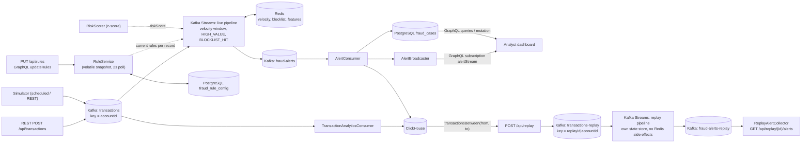

# Real-Time Fraud / Transaction Monitoring

[](https://github.com/Ashishk9670/fraud-monitoring/actions/workflows/ci.yml)
[](https://github.com/Ashishk9670/fraud-monitoring/actions/workflows/codeql.yml)
[](https://github.com/Ashishk9670/fraud-monitoring/actions/workflows/trivy.yml)
[](https://github.com/Ashishk9670/fraud-monitoring/actions/workflows/k8s.yml)


Spring Boot 3.5 / Java 21 service that ingests payment transactions, detects fraud in real time with
Kafka Streams, and exposes cases, alerts and a live alert stream to analysts via GraphQL and a small web dashboard.

## Architecture



* **Kafka Streams** (`streams/FraudTopology`): event-time windows (`TransactionTimestampExtractor`), a stateful
  `TxnStats` aggregate that flags the *first* threshold crossing per window so each window alerts once. Record caching is
  disabled (`statestore.cache.max.bytes=0`) so no update is coalesced away.
* **Redis**: `BlocklistService`, `VelocityCounter`, `FeatureStore` interfaces with Redis implementations; the topology
  only sees the interfaces (easy to unit test). Redis failures are logged and never kill the stream thread.
* **Analytics**: `AnalyticsStore` interface; ClickHouse implementation talks to the HTTP interface (no JDBC driver).
  `analytics.store=memory` selects an in-memory implementation.
* **PostgreSQL**: `fraud_cases` and `fraud_rule_config` tables managed by Flyway (`db/migration`), JPA entity `FraudCase`.
* **GraphQL** (`graphql/schema.graphqls`): queries `cases`, `case`, `alerts`, `alertCountsByRule`, `topRiskAccounts`;
  mutations `updateCase`, `updateRules`; queries also include `rules`; subscription `alertStream(minSeverity)`. GraphiQL at `/graphiql`.

## Run it

Requirements: JDK 21, Maven, Docker.

```bash
docker compose up -d --wait          # Kafka, Redis, Postgres, ClickHouse
mvn spring-boot:run                  # or: make run
# with continuous synthetic traffic (+ occasional fraud bursts):
mvn spring-boot:run -Dspring-boot.run.arguments=--simulator.enabled=true
```

Open http://localhost:8080 (dashboard) or http://localhost:8080/graphiql.

```bash
# ingest a transaction
curl -XPOST localhost:8080/api/transactions -H 'content-type: application/json' \
  -d '{"accountId":"acct-1","merchantId":"m-1","amount":42.5,"currency":"USD","location":"US"}'

# trigger a multi-location fraud burst (12 txns hopping between countries)
curl -XPOST 'localhost:8080/api/simulator/fraud-burst?accountId=acct-demo&count=12'

# blocklist an account (optionally ttlSeconds), inspect Redis features
curl -XPOST localhost:8080/api/blocklist -H 'content-type: application/json' -d '{"type":"ACCOUNT","value":"acct-9","reason":"mule"}'
curl localhost:8080/api/accounts/acct-demo/features
```

GraphQL examples:

```graphql
subscription { alertStream(minSeverity: HIGH) { accountId rule severity reason } }
{ cases(status: OPEN, limit: 20) { id accountId rule severity status } }
mutation { updateCase(id: "<uuid>", status: CONFIRMED_FRAUD, assignee: "alice") { status } }
```

Rule thresholds are seeded from `fraud.rules.*` in `application.yml` on first start and are then owned by Postgres
(see [Runtime-configurable rules](#runtime-configurable-rules)).

## Runtime-configurable rules

The windowed rule (window size, transaction-count threshold, minimum distinct locations) and the high-value amount are
stored in the single-row `fraud_rule_config` table (Flyway `V2`). `RuleService` keeps a volatile snapshot that the
topology reads for every record, so a change applies **without restarting** the topology; it is refreshed immediately on
update and re-read from Postgres every `fraud.rules-reload-ms` (default 2000) so every instance converges. Updates are
partial (omitted fields keep their value), validated (window 1-3600 s, count 1-100000, locations 1-1000, amount > 0) and
audited by `updatedBy`/`updatedAt`. A window-size change affects windows opened afterwards.

```bash
curl -H 'X-API-Key: dev-local-key' localhost:8080/api/rules
curl -XPUT -H 'X-API-Key: dev-local-key' -H 'content-type: application/json' localhost:8080/api/rules \
  -d '{"windowSeconds":30,"maxTransactions":3,"highValueAmount":2500}'
```

```graphql
{ rules { windowSeconds maxTransactions minDistinctLocations highValueAmount updatedBy } }
mutation { updateRules(input: {maxTransactions: 3, highValueAmount: 2500}) { maxTransactions highValueAmount } }
```

## Risk scoring

Alerts carry an optional `riskScore` in [0, 1] (REST/Kafka JSON, GraphQL `Alert.riskScore`, ClickHouse `risk_score`).
`RiskScorer` is the extension point: declare your own `RiskScorer` bean to replace the default `ZScoreRiskScorer`, which
computes a one-sided z-score of the triggering amount against the account's history in the Redis feature store
(`txn_count`, `total_amount`, `total_amount_sq`; the current transaction is excluded) and maps it to `z / 6` clamped to
[0, 1]. With fewer than 5 prior transactions no score is produced (`null`). Scoring is best effort and never fails the stream.

## Replaying history

`POST /api/replay` re-feeds stored transactions (from ClickHouse, or the in-memory store) through the **current rules** to
see what they would flag, without touching live state: records go to `transactions-replay` keyed `replayId|accountId`, are
processed by a separate pipeline in the same topology (own window store, no velocity/feature side effects), and alerts land
on `fraud-alerts-replay` instead of creating cases. Range is capped at 7 days and `limit` (default 10 000, max 100 000).

```bash
curl -XPOST -H 'X-API-Key: dev-local-key' -H 'content-type: application/json' localhost:8080/api/replay \
  -d '{"from":"2025-01-01T00:00:00Z","to":"2025-01-02T00:00:00Z","limit":50000}'   # -> {"id":"1a2b3c4d",...}
curl -H 'X-API-Key: dev-local-key' localhost:8080/api/replay/1a2b3c4d          # run + alert count
curl -H 'X-API-Key: dev-local-key' localhost:8080/api/replay/1a2b3c4d/alerts   # alerts produced by that run
```

Architecture decisions are recorded in [`docs/adr/`](docs/adr/).

## Deploy

- `deploy/k8s/`: plain manifests (kustomize).
- `deploy/helm/fraud-monitoring/`: Helm chart (`helm install fraud deploy/helm/fraud-monitoring`); config in `values.yaml`,
  secrets come from an existing Secret (`existingSecret`).
- `deploy/secrets-examples/`: External Secrets and Sealed Secrets examples (placeholders only, no real secrets).
- `deploy/argocd/application.yaml`: example Argo CD Application. CI (`helm.yml`) runs `helm lint` and validates the
  rendered chart and the examples with kubeconform.

## Observability

`make observability-up` starts Prometheus (9090, alert rules), Grafana (3000), Loki + Alloy (container logs) and Tempo
(OTLP traces on 4318). Grafana is provisioned with Prometheus, Loki and Tempo datasources: log lines carry the trace id
(`[fraud-monitoring,<traceId>,<spanId>]`) and link to the trace in Tempo, and a Tempo span links back to its logs.
Enable tracing with `TRACING_ENABLED=true`.

SLO alerts live in [`monitoring/alerts.yml`](monitoring/alerts.yml) (alert latency, 5xx error rate, consumer lag, publish
failures, app down), unit-tested with `promtool` (`make lint-monitoring`). Each alert links to a runbook in
[`docs/runbooks/`](docs/runbooks/).

## Tests

| Layer | What | Needs Docker | Command |
|---|---|---|---|
| Unit | `TopologyTestDriver` topology tests (incl. hot reload, scoring, replay isolation), `TxnStats`, rules/scorer/replay services, JSON serde, generator, Redis services (Mockito), alert consumer | no | `mvn test` |
| Property | jqwik properties for window arithmetic, threshold folding, rule validation and score bounds (`WindowPropertiesTest`) | no | `mvn test` |
| Architecture | ArchUnit package-boundary rules (`ArchitectureTest`) | no | `mvn test` |
| API | Full Spring context: REST (RestAssured), GraphQL queries/mutation/subscription, SSE, Kafka Streams end to end. Uses embedded Kafka, H2 (PostgreSQL mode), in-memory analytics and fake Redis (`application-test.yml`, `TestInfra`) | no | `mvn test` |
| Contract | Real serialized alert/transaction events validated against the JSON schemas referenced by `asyncapi/asyncapi.yaml` (`EventContractTest`); GraphQL schema snapshot (`GraphQlSchemaSnapshotTest`, update with `-Dgraphql.snapshot.update=true`) | no | `mvn test` |
| Integration | `*IT` classes with Testcontainers: real Kafka, Redis, Postgres, ClickHouse (`FullStackIT`). Skipped automatically when Docker is unavailable | yes | `mvn verify` |
| Chaos | `ChaosIT`: Toxiproxy cuts Redis, then Kafka, mid-run; asserts graceful degradation and automatic recovery | yes | `mvn verify` |
| Mutation | PIT on `streams`, `rules`, `scoring` (optional; CI workflow `mutation.yml`, manual + weekly; threshold in `pom.xml`) | no | `mvn -Pmutation test-compile org.pitest:pitest-maven:mutationCoverage` |
| E2E UI | Playwright (`e2e/`) drives the dashboard against a running stack | yes (or local stand-in) | see below |

Coverage: Jacoco runs with the tests; report at `target/site/jacoco/index.html` (`mvn verify`).

### Playwright e2e

```bash
docker compose up -d --wait && mvn -DskipTests package && java -jar target/fraud-monitoring-*-SNAPSHOT.jar &
cd e2e && npm ci && npx playwright install chromium && npx playwright test   # BASE_URL overrides http://localhost:8080
```

Without Docker you can run the same suite against a stand-in app (embedded Kafka, H2, fake Redis):
`make e2e-local-app` in one terminal, `make e2e` in another.

### Supply chain

CI uploads a CycloneDX SBOM (`sbom-cyclonedx` artifact). The release workflow (tag `v*.*.*`) signs the image with
cosign keyless (GitHub OIDC) and attaches the SBOM as an attestation; verify with
`cosign verify ghcr.io/ashishk9670/fraud-monitoring:<tag> --certificate-identity-regexp 'github.com/Ashishk9670/fraud-monitoring' --certificate-oidc-issuer https://token.actions.githubusercontent.com`.
An OpenSSF Scorecard workflow runs weekly.

### CI

`.github/workflows/ci.yml`: build + unit/API tests with Jacoco, Testcontainers integration tests, and Playwright e2e
(`docker compose up`, app jar, browsers installed, HTML report uploaded as an artifact).

## Layout

```
src/main/java/com/example/fraud
  streams/    FraudTopology (live + replay pipelines), WindowedVelocityProcessor, WindowMath, TxnStats
  rules/      runtime-editable rules: RuleService, RulesProvider, REST controller, JPA entity
  scoring/    RiskScorer hook + default ZScoreRiskScorer
  replay/     ReplayService, ReplayAlertCollector, REST controller
  redis/      blocklist, velocity counters, feature store (interfaces + Redis impls)
  analytics/  AnalyticsStore, ClickHouse + in-memory impls
  cases/      JPA entity, repository, service
  messaging/  Kafka producer/consumers, live alert broadcaster
  graphql/    GraphQL controller          web/  REST controllers
  simulator/  synthetic data generator + scheduler
```
